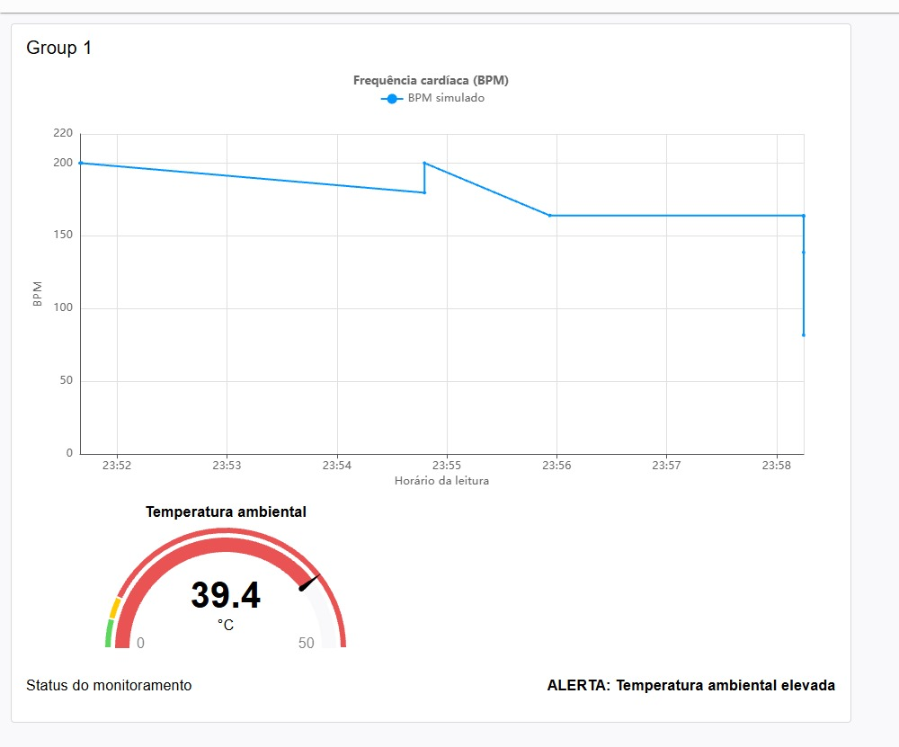
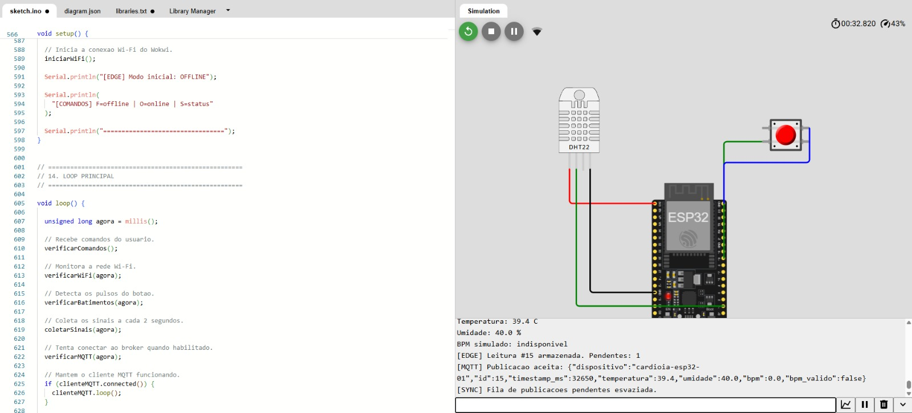
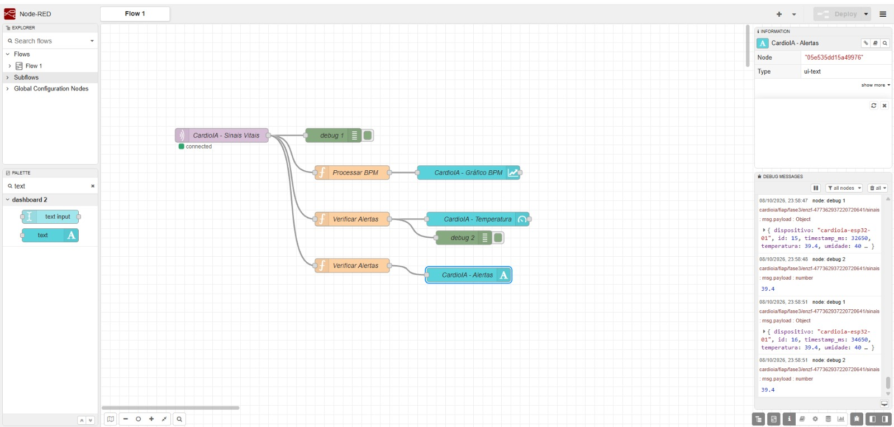

# CardioIA — Fase 3: Monitoramento Contínuo — IoT na Saúde

> ⚠️ **AVISO CLÍNICO:** Este sistema é um protótipo acadêmico e **NÃO** substitui avaliação médica.
> Supervisionado por Dra. Fernanda Fassina (CRM-SP 169944).

Protótipo de monitoramento contínuo de sinais vitais que integra **Edge Computing**, **MQTT** e **dashboard Node-RED**. Um ESP32 simulado no Wokwi coleta dados, guarda-os localmente quando a transmissão está indisponível e os sincroniza ao reconectar; o Node-RED, inscrito no mesmo tópico MQTT, exibe gráfico, medidor e alertas.

Todos os dados são **simulados**: nenhum dado real de paciente é coletado, armazenado ou transmitido.

## Integrantes

| Nome completo | RM |
|---|---|
| Caroline de Castro Corrêa | RM567255 |
| Enzo França Sader | RM566928 |
| Lucas Hideki Oliveira Koyama | RM566925 |
| Rodrigo Dias Figueiroa | RM567800 |
| Tiago Lindgren Curi | RM567016 |

## Links

- **Projeto no Wokwi:** https://wokwi.com/projects/477362937220720641
- **Repositório:** https://github.com/Grupo-S-faculdade-FIAP/cardioIA
- **Relatório da Parte 1 (Edge Computing):** [`docs/relatorio_edge.md`](docs/relatorio_edge.md)
- **Relatório da Parte 2 (MQTT e dashboard):** [`docs/relatorio_mqtt.md`](docs/relatorio_mqtt.md)

## Arquitetura

```text
[DHT22 + botão] → ESP32 (Wokwi): coleta, estimativa de BPM e fila circular (Edge)
                        │
                        │ Wi-Fi (Wokwi-GUEST) / MQTT, TCP 1883, QoS 0
                        ▼
              broker.hivemq.com (público)
                        │
                        │ tópico cardioia/fiap/fase3/enzf-477362937220720641/sinais
                        ▼
              Node-RED (local) + Dashboard 2.0
                ├── gráfico de BPM simulado
                ├── gauge de temperatura ambiental
                └── texto de alerta automático
```

## Componentes e conexões

| Componente | Função | Ligação |
|---|---|---|
| ESP32 DevKit C v4 | Processamento, fila Edge, Wi-Fi e MQTT | — |
| DHT22 | Temperatura e umidade **ambientais** (conta como 1 sensor) | VCC → 3V3, SDA → GPIO 15, GND → GND |
| Pushbutton | Simula pulsos cardíacos: cada clique é um batimento | Terminal `2.l` → GPIO 18, terminal `1.r` → GND (`INPUT_PULLUP`) |

O BPM é calculado como `60000 / intervalo entre cliques (ms)`, aceito para intervalos de 300 a 2000 ms (30 a 200 BPM). Sem clique por 4 s, a estimativa expira e a leitura é marcada com `bpm_valido: false`.

## Parte 1 — Edge Computing e resiliência offline

**Status: concluída.**

- Leitura do DHT22 a cada 2 s e detecção de pulsos do botão com *debounce* (40 ms), sem `delay()`.
- Toda leitura entra primeiro em uma **fila circular em RAM com 1.800 posições**, o equivalente a cerca de 1 hora de coleta (1.800 × 2 s).
- A variável booleana `envioHabilitado` simula a conectividade. O dispositivo **inicia offline** para evidenciar a resiliência: a coleta continua e a fila cresce.
- Ao habilitar o envio, o ESP32 conecta no Wi-Fi e no broker e esvazia a fila **em ordem de coleta**, até 10 leituras por passagem do `loop()`.
- Se a fila enche, a leitura **mais antiga é descartada** e o evento é contado (`Leituras descartadas` no status).
- Uma leitura só sai da fila depois que `mqtt.publish()` a aceita; se a publicação falha, ela permanece pendente.

### Comandos no Monitor Serial

| Comando | Ação |
|---|---|
| `f` | Simula perda de conexão (desabilita o envio e desconecta do broker) |
| `o` | Restaura a conexão (habilita o envio e sincroniza a fila) |
| `s` | Exibe o status: conectividade, leituras pendentes e descartadas |

### SPIFFS

O uso de SPIFFS é opcional e só persiste em ESP32 físico (no simulador o sistema de arquivos é volátil). Por isso a fila fica em RAM, e o Monitor Serial é a alternativa de resiliência permitida pelo enunciado.

## Parte 2 — Transmissão MQTT e dashboard (Fog/Cloud)

**Status: concluída.**

- **Broker:** `broker.hivemq.com`, porta `1883`, sem TLS e sem autenticação.
- **Tópico:** `cardioia/fiap/fase3/enzf-477362937220720641/sinais`
- **Biblioteca:** PubSubClient, publicação com **QoS 0**.

Exemplo de mensagem:

```json
{
  "dispositivo": "cardioia-esp32-01",
  "id": 9,
  "timestamp_ms": 18000,
  "temperatura": 24.0,
  "umidade": 40.0,
  "bpm": 0.0,
  "bpm_valido": false
}
```

`timestamp_ms` é o `millis()` do ESP32 desde a inicialização, **não** um horário civil.

### Dashboard Node-RED

O fluxo exportado está em [`node_red/cardioia-fase3-flow.json`](node_red/cardioia-fase3-flow.json) (Dashboard 2.0, `@flowfuse/node-red-dashboard` 1.33.0).

| Widget | O que mostra | Regra |
|---|---|---|
| Gráfico de linha | Frequência cardíaca (BPM simulado) | Só plota leituras com `bpm_valido = true` |
| Gauge | Temperatura ambiental (°C), escala de 0 a 50 | Verde até 30 °C, amarelo de 30 a 38 °C, vermelho a partir de 38 °C |
| Texto de status | Alertas automáticos | Ver tabela abaixo |

| Condição | Mensagem exibida |
|---|---|
| BPM válido **> 120** | `ALERTA: BPM simulado elevado` |
| Temperatura **> 38 °C** | `ALERTA: Temperatura ambiental elevada` |
| As duas acima | `ALERTA: BPM simulado elevado \| Temperatura ambiental elevada` |
| Nenhuma | `Monitoramento sem alertas ativos` |

Os limiares são **regras demonstrativas** do exercício. O DHT22 mede temperatura do ambiente, então o alerta de temperatura **não indica febre**.

## Como executar

### 1. Simulação (Wokwi)

1. Abra o projeto no Wokwi e inicie a simulação.
2. Observe o Monitor Serial: o dispositivo começa **offline**, coletando e guardando leituras (`[EDGE] Leitura #N armazenada`).
3. Clique no botão em ritmo constante para simular pulsos e ver o BPM.
4. Digite `s` para ver o status e, depois, `o` para habilitar o envio: o ESP32 conecta e publica as leituras pendentes (`[MQTT] Publicacao aceita`, `[SYNC]`).
5. Digite `f` para simular nova queda e `o` para sincronizar de novo.

Para provocar os alertas: cliques com intervalo menor que 500 ms resultam em BPM acima de 120; clicando no DHT22 e ajustando a temperatura para 39 °C, o alerta de temperatura é disparado.

### 2. Dashboard (Node-RED)

1. Instale o Node-RED e, na paleta, o pacote `@flowfuse/node-red-dashboard`.
2. Importe [`node_red/cardioia-fase3-flow.json`](node_red/cardioia-fase3-flow.json) (Menu → Import).
3. Confirme que o nó de broker `HiveMQ - CardioIA` está conectado a `broker.hivemq.com:1883` e clique em **Deploy**.
4. Com o Wokwi em execução e o envio habilitado (`o`), abra http://localhost:1880/dashboard.

## Evidências

As capturas ficam em [`docs/evidencias/`](docs/evidencias/). Foram feitas em 08 e 09/10/2026, **antes da refatoração final do `sketch.ino`**, então o texto exato das mensagens do Monitor Serial pode diferir do sketch atual. O fluxo demonstrado (coleta, fila, publicação MQTT e dashboard) é o mesmo.

**Dashboard com alerta de temperatura (DHT22 ajustado para 39,4 °C):**



**Wokwi: circuito, Monitor Serial e publicação MQTT (leitura #15):**



**Editor do Node-RED: fluxo conectado ao broker e mensagens recebidas (leitura #15 no debug):**



## Estrutura

```text
fase3/
├── esp32/
│   ├── sketch.ino          # firmware comentado (C++/Arduino)
│   ├── diagram.json        # circuito do Wokwi
│   └── libraries.txt       # DHT sensor library for ESPx, PubSubClient
├── node_red/
│   └── cardioia-fase3-flow.json   # fluxo + dashboard exportados
├── docs/
│   ├── relatorio_edge.md   # relatório da Parte 1 (+ .pdf com as mesmas informações)
│   ├── relatorio_mqtt.md   # relatório da Parte 2 (+ .pdf com as mesmas informações)
│   └── evidencias/         # prints numerados
└── README.md
```

## Limitações e segurança

- **Armazenamento volátil:** a fila vive em RAM. Reiniciar o ESP32 apaga as leituras ainda não enviadas.
- **QoS 0:** `publish()` aceito significa que a biblioteca enviou a mensagem, não que o broker ou o Node-RED a receberam. Não há confirmação ponta a ponta.
- **Broker público e sem criptografia:** adequado apenas a dados fictícios. Em produção seriam necessários TLS, autenticação e controle de acesso por tópico.
- **Sem relógio real:** `timestamp_ms` é relativo ao boot. Leituras reenviadas após a reconexão aparecem no gráfico no horário de chegada, não no de coleta.
- **Alertas só na camada Fog:** os limiares são avaliados no Node-RED; com o dispositivo offline não há alerta.
- **Sinais não fisiológicos:** o DHT22 mede o ambiente e o BPM vem de cliques manuais. Nada aqui é uma medição clínica.
