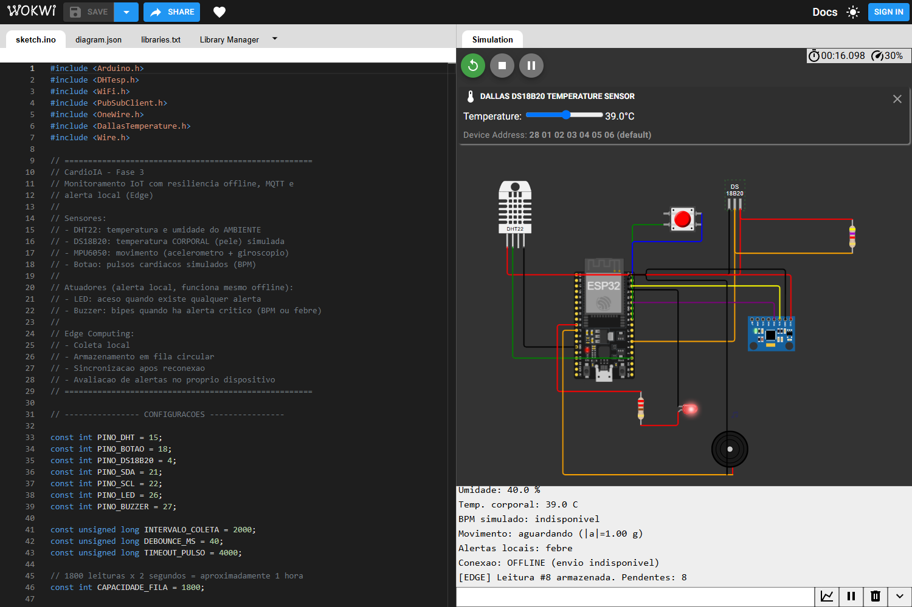
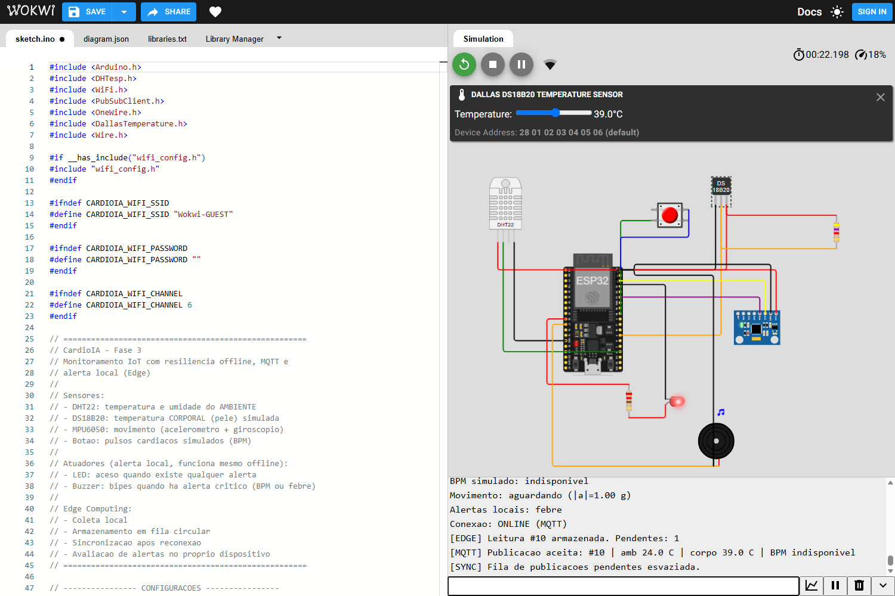
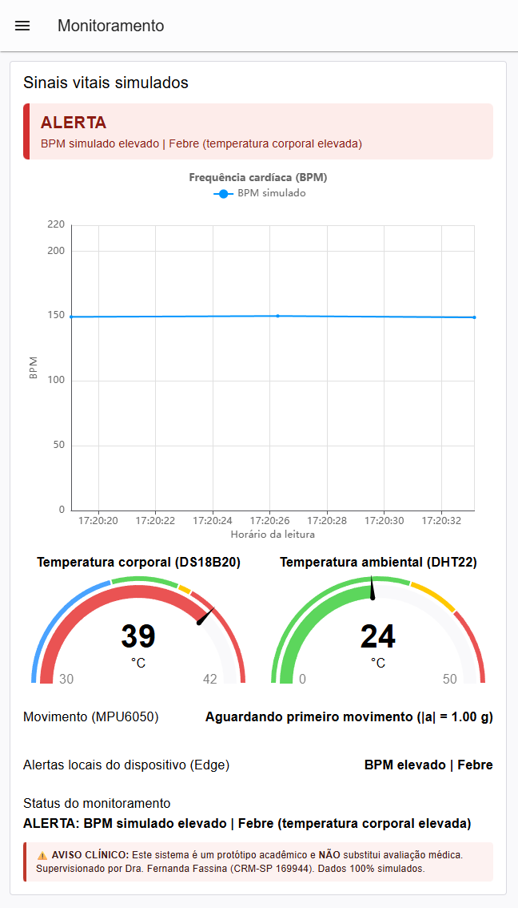
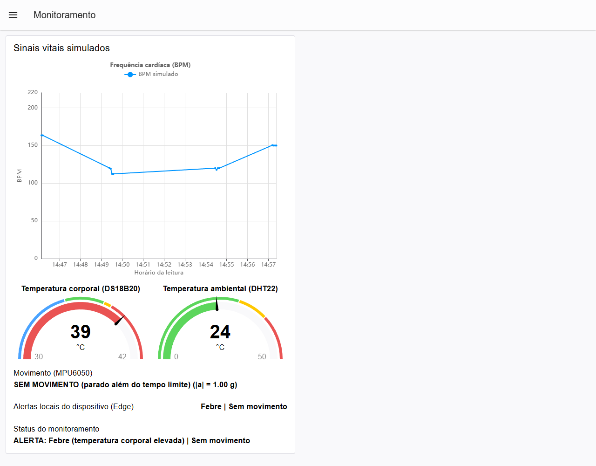

# CardioIA — Fase 3: Monitoramento Contínuo — IoT na Saúde

> ⚠️ **AVISO CLÍNICO:** Este sistema é um protótipo acadêmico e **NÃO** substitui avaliação médica.
> Supervisionado por Dra. Fernanda Fassina (CRM-SP 169944).

Protótipo de monitoramento contínuo de sinais vitais que integra **Edge Computing**, **MQTT** e **dashboard Node-RED**. Um ESP32 simulado no Wokwi lê quatro fontes de dados (temperatura ambiental, temperatura corporal, movimento e batimentos), avalia **alertas no próprio dispositivo** (LED e buzzer, mesmo offline), guarda as leituras localmente quando a transmissão está indisponível e as sincroniza ao reconectar. O Node-RED, inscrito no mesmo tópico MQTT, exibe gráfico, medidores e alertas.

Todos os dados são **simulados**: nenhum dado real de paciente é coletado, armazenado ou transmitido.

## Integrantes

| Nome completo | RM |
|---|---|
| Caroline de Castro Corrêa | RM567255 |
| Enzo França Sader | RM566928 |
| Lucas Hideki Oliveira Koyama | RM566925 |
| Rodrigo Dias Figueiroa | RM567800 |
| Tiago Lindgren Curi | RM567016 |

## Links

- **Projeto no Wokwi:** https://wokwi.com/projects/479773169716093953
- **Repositório:** https://github.com/Grupo-S-faculdade-FIAP/cardioIA
- **Relatório da Parte 1 (Edge Computing):** [`docs/relatorio_edge.md`](docs/relatorio_edge.md)
- **Relatório da Parte 2 (MQTT e dashboard):** [`docs/relatorio_mqtt.md`](docs/relatorio_mqtt.md)
- **Roteiro de teste no Wokwi:** [`docs/roteiro_teste_wokwi.md`](docs/roteiro_teste_wokwi.md)
- **Contrato MQTT (payload, tópico e limiares):** [`docs/contrato_mqtt.md`](docs/contrato_mqtt.md)
- **Node-RED (como rodar e testar o dashboard):** [`node_red/README.md`](node_red/README.md)

## Arquitetura

```text
 DHT22 (ambiente) ─┐
 DS18B20 (corpo) ──┤
 MPU6050 (mov.) ───┼──► ESP32 (Wokwi) ──► LED + buzzer   (alerta LOCAL, funciona offline)
 Botão (BPM) ──────┘        │
                            │ fila circular (Edge) · Wi-Fi Wokwi-GUEST · MQTT, TCP 1883, QoS 0
                            ▼
                  broker.hivemq.com (público)
                            │  tópico cardioia/fiap/fase3/enzf-477362937220720641/sinais
                            ▼
                  Node-RED (local) + Dashboard 2.0
                    ├── gráfico de BPM simulado
                    ├── gauge de temperatura corporal e gauge de temperatura ambiental
                    ├── movimento e alertas locais do dispositivo
                    └── texto de alerta automático (regras do Fog)
```

## Componentes e conexões

| Componente | Função | Ligação (ESP32) |
|---|---|---|
| ESP32 DevKit C v4 | Processamento, fila Edge, alertas, Wi-Fi e MQTT | — |
| DHT22 | Temperatura e umidade **do ambiente** | SDA → GPIO 15, VCC → 3V3, GND |
| DS18B20 (+ resistor de 4,7 kΩ) | Temperatura **corporal** simulada (pele) | DQ → GPIO 4, VCC → 3V3, GND; resistor de pull-up entre DQ e VCC |
| MPU6050 | Movimento: acelerômetro e giroscópio (I2C, endereço 0x68) | SDA → GPIO 21, SCL → GPIO 22, VCC → 3V3, GND |
| Pushbutton | Simula pulsos cardíacos: cada clique é um batimento | Terminal `2.l` → GPIO 18, terminal `1.r` → GND (`INPUT_PULLUP`); tecla de atalho `b` |
| LED vermelho (+ resistor de 220 Ω) | Alerta local de qualquer tipo | GPIO 26 → resistor → LED → GND |
| Buzzer | Alerta local sonoro (alertas críticos) | GPIO 27 → pino 2 (+); pino 1 → GND |

O enunciado conta o DHT22 como 1 sensor; o projeto tem **4 fontes de dados** (DHT22, DS18B20, MPU6050 e botão).

### Configurar o Wi-Fi

O firmware usa `Wokwi-GUEST` sem senha quando não encontra configuração local, como esperado na simulação. Para executar em um ESP32 conectado ao seu roteador:

1. Copie `esp32/wifi_config.example.h` para `esp32/wifi_config.h`.
2. Preencha `CARDIOIA_WIFI_SSID` e `CARDIOIA_WIFI_PASSWORD` com o nome e a senha da sua rede; mantenha `CARDIOIA_WIFI_CHANNEL` em `0` para detectar o canal automaticamente.
3. Compile e grave o firmware no ESP32. O arquivo `wifi_config.h` é ignorado pelo Git para evitar publicar a senha.

Não use as credenciais do roteador no projeto público do Wokwi. A simulação deve continuar usando `Wokwi-GUEST`.

### Como cada sinal é obtido

- **BPM:** `60000 / intervalo entre cliques (ms)`, aceito para intervalos de 300 a 2000 ms (30 a 200 BPM). Sem clique por 4 s, a estimativa expira e a leitura é marcada com `bpm_valido: false`.
- **Temperatura corporal:** o DS18B20 é lido sem bloquear o `loop()` (a conversão é pedida e o resultado lido ~0,8 s depois). No Wokwi, clique no sensor para mudar a temperatura (inicia em 36,5 °C).
- **Movimento:** o MPU6050 é lido a cada 100 ms. Há movimento quando a aceleração varia mais de 0,05 g entre amostras ou o giro passa de 10 °/s. Um valor constante (parado, mesmo inclinado) não conta. Estados: `aguardando` (ainda sem movimento desde o boot), `ativo`, `parado` (sem movimento por 15 s depois de já ter havido movimento) e `indisponivel` (sensor não responde). O alerta só vale depois do primeiro movimento, para um dispositivo guardado em repouso não alertar. Os 15 s são um valor de demonstração; em uso real seriam minutos.

## Alertas

Os alertas são avaliados em **dois lugares**: no ESP32 (Edge, aciona LED e buzzer mesmo sem rede) e no Node-RED (Fog, texto no dashboard). Os limiares são os mesmos nos dois e são **regras demonstrativas**, não critérios de diagnóstico.

| Condição | Edge (ESP32) | Dashboard (Node-RED) |
|---|---|---|
| BPM válido **> 120** | LED + buzzer | `BPM simulado elevado` |
| Temperatura corporal (DS18B20) **> 38 °C** | LED + buzzer | `Febre (temperatura corporal elevada)` |
| Parado por 15 s depois de já ter havido movimento | LED (sem buzzer) | `Sem movimento` |
| Temperatura ambiental (DHT22) **> 38 °C** | — | `Temperatura ambiental elevada` |

No dashboard, alertas simultâneos são concatenados com ` | ` depois de `ALERTA: `; sem nenhum, o texto é `Monitoramento sem alertas ativos`. O buzzer dá um bipe de 150 ms por segundo enquanto houver alerta crítico (BPM ou febre). No boot há um autoteste de 200 ms do LED e do buzzer.

## Parte 1 — Edge Computing e resiliência offline

**Status: concluída.**

- Leitura do DHT22 a cada 2 s e detecção de pulsos do botão com *debounce* (40 ms), sem `delay()` no fluxo principal.
- Toda leitura entra primeiro em uma **fila circular em RAM com 1.800 posições** (32 bytes cada, 57,6 KB), o equivalente a cerca de 1 hora de coleta (1.800 × 2 s).
- A variável booleana `envioHabilitado` simula a conectividade. O dispositivo **inicia offline** para evidenciar a resiliência: a coleta e os alertas locais continuam e a fila cresce.
- Ao habilitar o envio, o ESP32 conecta no Wi-Fi e no broker e esvazia a fila **em ordem de coleta**, até 10 leituras por passagem do `loop()`.
- Se a fila enche, a leitura **mais antiga é descartada** e o evento é contado (`Leituras descartadas` no status).
- Uma leitura só sai da fila depois que `mqtt.publish()` a aceita; se a publicação falha, ela permanece pendente.

### Comandos no Monitor Serial

| Comando | Ação |
|---|---|
| `f` | Simula perda de conexão (desabilita o envio e desconecta do broker) |
| `o` | Restaura a conexão (habilita o envio e sincroniza a fila) |
| `s` | Exibe o status: conectividade, pendentes, descartadas, temperatura corporal, movimento e alertas locais |

### SPIFFS

O uso de SPIFFS é opcional e só persiste em ESP32 físico (no simulador o sistema de arquivos é volátil). Por isso a fila fica em RAM, e o Monitor Serial é a alternativa de resiliência permitida pelo enunciado.

## Parte 2 — Transmissão MQTT e dashboard (Fog/Cloud)

**Status: concluída.**

- **Broker:** `broker.hivemq.com`, porta `1883`, sem TLS e sem autenticação.
- **Tópico:** `cardioia/fiap/fase3/enzf-477362937220720641/sinais`
- **Biblioteca:** PubSubClient, publicação com **QoS 0**.

Exemplo de mensagem:

```json
{
  "dispositivo": "cardioia-esp32-01",
  "id": 9,
  "timestamp_ms": 18000,
  "temperatura": 24.0,
  "umidade": 40.0,
  "temp_corporal": 36.5,
  "temp_corporal_valida": true,
  "bpm": 0.0,
  "bpm_valido": false,
  "movimento": "aguardando",
  "aceleracao_g": 1.00,
  "alertas_locais": 0
}
```

| Campo | Significado |
|---|---|
| `timestamp_ms` | `millis()` do ESP32 desde a inicialização, **não** um horário civil |
| `temperatura`, `umidade` | DHT22 (ambiente) |
| `temp_corporal`, `temp_corporal_valida` | DS18B20; com `false` o valor deve ser ignorado |
| `bpm`, `bpm_valido` | Estimativa pelo botão; com `false` o valor deve ser ignorado |
| `movimento` | `aguardando`, `ativo`, `parado` ou `indisponivel` |
| `aceleracao_g` | Módulo da aceleração (≈ 1,00 em repouso) |
| `alertas_locais` | Máscara de bits decidida pelo ESP32: 1 = BPM, 2 = febre, 4 = sem movimento |

### Dashboard Node-RED

O fluxo exportado está em [`node_red/cardioia-fase3-flow.json`](node_red/cardioia-fase3-flow.json) (Dashboard 2.0, `@flowfuse/node-red-dashboard` 1.33.0).

| Widget | O que mostra | Regra |
|---|---|---|
| Gráfico de linha | Frequência cardíaca (BPM simulado) | Só plota leituras com `bpm_valido = true` |
| Gauge | Temperatura corporal (DS18B20), escala de 30 a 42 °C | Azul até 35 °C, verde de 35 a 37,5 °C, amarelo de 37,5 a 38 °C, vermelho a partir de 38 °C |
| Gauge | Temperatura ambiental (DHT22), escala de 0 a 50 °C | Verde até 30 °C, amarelo de 30 a 38 °C, vermelho a partir de 38 °C |
| Texto | Movimento (MPU6050) | `Em movimento`, `Aguardando primeiro movimento`, `SEM MOVIMENTO…` ou `Sensor de movimento indisponível`, com o módulo da aceleração |
| Texto | Alertas locais do dispositivo (Edge) | Decodifica `alertas_locais`: `Nenhum` ou a lista (`BPM elevado`, `Febre`, `Sem movimento`) |
| Texto | Status do monitoramento (Fog) | Regras da tabela de alertas acima |

O DHT22 mede o ambiente: o alerta de temperatura ambiental **não indica febre**. A febre é avaliada no DS18B20.

## Como executar

### 1. Simulação (Wokwi)

1. Abra o projeto no Wokwi e inicie a simulação. Confirme no Serial que o DS18B20 e o MPU6050 foram encontrados.
2. O dispositivo começa **offline**, coletando e guardando leituras (`[EDGE] Leitura #N armazenada`).
3. Pulsos: clique no botão vermelho (ou use a tecla `b`) em ritmo constante e veja o BPM.
4. Digite `s` para ver o status e, depois, `o` para habilitar o envio: o ESP32 conecta e publica as leituras pendentes (`[MQTT] Publicacao aceita`, `[SYNC]`).
5. Digite `f` para simular nova queda e `o` para sincronizar de novo.

Para provocar cada alerta:

| Alerta | Como provocar |
|---|---|
| BPM | Cliques com intervalo entre 300 e 500 ms (BPM acima de 120) |
| Febre | Clique no DS18B20 e ajuste a temperatura para 39 °C |
| Sem movimento | Clique no MPU6050 e mexa nos controles de aceleração ou rotação (ex.: rotação em X = 50 °/s) para registrar movimento; volte tudo ao repouso (aceleração Z = 1 g, demais 0) e aguarde 15 s |
| Ambiente quente | Clique no DHT22 e ajuste a temperatura para 39 °C |

### 2. Dashboard (Node-RED)

1. Instale o Node-RED 5.0.9 e, na pasta de usuário dele, o pacote `@flowfuse/node-red-dashboard@1.33.0` (passo a passo em [`node_red/README.md`](node_red/README.md)).
2. Importe [`node_red/cardioia-fase3-flow.json`](node_red/cardioia-fase3-flow.json) (Menu → Import).
3. Confirme que o nó de broker `HiveMQ - CardioIA` está conectado a `broker.hivemq.com:1883` e clique em **Deploy**.
4. Com o Wokwi em execução e o envio habilitado (`o`), abra http://localhost:1880/dashboard.

Os testes automatizados do fluxo (regras de cada nó e contrato firmware × fluxo × documentos) rodam com `npm test` dentro de `fase3/node_red`.

## Evidências

Todas as leituras vêm do **ESP32 simulado no Wokwi**: este projeto não usa hardware físico. As capturas ficam em [`docs/evidencias/validacao-2026-11-04/`](docs/evidencias/validacao-2026-11-04/); as capturas antigas, de uma versão anterior do firmware, foram removidas.

**Execução final no projeto do Wokwi indicado em "Links"** (ID 479773169716093953, em 2026-11-04). O projeto tem `sketch.ino`, compila e roda; os arquivos são os de `esp32/`, exceto pela configuração opcional de Wi-Fi do `sketch.ino`, que usa `Wokwi-GUEST` por padrão e não muda o comportamento na simulação. A simulação rodou em sessão anônima de um navegador automatizado (de 35 % a 80 % da velocidade real) e o dashboard foi o do Node-RED local, lendo o broker público. Foram 32 verificações, todas aprovadas:

| Etapa | O que ficou comprovado | Captura |
|---|---|---|
| Boot e coleta offline | título do firmware; DS18B20 e MPU6050 encontrados; modo inicial OFFLINE; leituras #1 a #N sem pulos e `Pendentes = N`; sem alerta de "sem movimento" antes do primeiro movimento; LED apagado | [12](docs/evidencias/validacao-2026-11-04/12-wokwi-projeto-final-boot-e-coleta-offline.png) |
| Alerta local offline | DS18B20 em 39 °C: `[ALERTA-LOCAL] ATIVO: febre`, LED aceso e buzzer ativo, sem nada chegar ao dashboard | [13](docs/evidencias/validacao-2026-11-04/13-wokwi-projeto-final-alerta-febre-led-offline.png) |
| Sincronização | após `o`: Wi-Fi e broker conectados, publicações #1 em diante em ordem, sem pulo nem repetição, e `[SYNC] Fila de publicacoes pendentes esvaziada.` | [14](docs/evidencias/validacao-2026-11-04/14-wokwi-projeto-final-sincronizacao-mqtt.png) |
| Dashboard recebe do Wokwi | gauge corporal em 39 °C, ambiente em 24 °C, `Alertas locais: Febre` e `ALERTA: Febre (temperatura corporal elevada)` | [17](docs/evidencias/validacao-2026-11-04/17-dashboard-febre-recebida-do-wokwi.png) |
| BPM pelo botão | 14 cliques a cerca de 150 BPM registrados como pulsos; alerta local de BPM elevado junto com a febre; o BPM expira 4 s depois do último clique | [15](docs/evidencias/validacao-2026-11-04/15-wokwi-projeto-final-bpm-por-cliques-e-alerta.png) |
| BPM no dashboard | gráfico de BPM com pontos e status com os alertas de BPM e de febre | [18](docs/evidencias/validacao-2026-11-04/18-dashboard-bpm-alerta-recebido-do-wokwi.png) |
| Sem movimento | MPU6050 girado (`Movimento: ativo`) e devolvido ao repouso: após 15 s, `Movimento: parado` e alerta local de sem movimento | [16](docs/evidencias/validacao-2026-11-04/16-wokwi-projeto-final-sem-movimento.png) |
| Sem movimento no dashboard | `SEM MOVIMENTO (parado além do tempo limite)` e status com o alerta de sem movimento | [19](docs/evidencias/validacao-2026-11-04/19-dashboard-sem-movimento-recebido-do-wokwi.png) |
| Queda e retorno | `f` desabilita o envio e a coleta e os alertas locais continuam; `s` mostra o status completo | — |









**Limites desta validação:** o buzzer foi verificado só pelo indicador visual de som do simulador (sem áudio); as 32 verificações foram feitas por um script de navegador que não está no repositório (o [roteiro](docs/roteiro_teste_wokwi.md) descreve os mesmos passos para execução manual); e ainda falta uma captura do editor do Node-RED com o fluxo carregado.

**Outras verificações:** 86 testes automatizados passaram ([09](docs/evidencias/validacao-2026-11-04/09-testes-automatizados-86-passaram.png)); o dashboard também processou uma mensagem sintética no formato do firmware ([07](docs/evidencias/validacao-2026-11-04/07-dashboard-baseline-node-red.png) e [08](docs/evidencias/validacao-2026-11-04/08-dashboard-mqtt-mensagem-sintetica.png); dado gerado pelo teste, não pelo Wokwi). Uma execução anterior, no projeto `cardioiaiot` (ID 479766849694291969), está nas capturas [01](docs/evidencias/validacao-2026-11-04/01-wokwi-circuito-serial-offline.png) e [05](docs/evidencias/validacao-2026-11-04/05-wokwi-serial-sincronizacao-mqtt.png), e a [06](docs/evidencias/validacao-2026-11-04/06-wokwi-simulacao-serial.png) registra a falha de build que o projeto do link tinha antes de receber o `sketch.ino`.

O protocolo completo de validação está em [`docs/roteiro_teste_wokwi.md`](docs/roteiro_teste_wokwi.md).

## Estrutura

```text
fase3/
├── esp32/
│   ├── sketch.ino          # firmware comentado (C++/Arduino)
│   ├── diagram.json        # circuito do Wokwi
│   ├── libraries.txt       # DHT sensor library for ESPx, PubSubClient, OneWire, DallasTemperature
│   └── wifi_config.example.h   # modelo do wifi_config.h local (ignorado pelo Git)
├── node_red/
│   ├── cardioia-fase3-flow.json   # fluxo + dashboard exportados
│   ├── README.md           # como rodar o dashboard e os testes
│   ├── package.json        # só os scripts de teste
│   └── tests/              # regras dos nós, contrato firmware × fluxo × documentos
├── docs/
│   ├── contrato_mqtt.md    # fonte única do payload, do tópico e dos limiares
│   ├── relatorio_edge.md   # relatório da Parte 1 (+ .pdf com as mesmas informações)
│   ├── relatorio_mqtt.md   # relatório da Parte 2 (+ .pdf com as mesmas informações)
│   ├── roteiro_teste_wokwi.md   # roteiro de teste manual no Wokwi
│   └── evidencias/         # prints numerados
└── README.md
```

## Do protótipo ao hardware real

No Wokwi não existe sensor de batimento cardíaco, por isso o botão faz o papel dele. Em um dispositivo real:

| No protótipo | Em hardware real |
|---|---|
| Botão (BPM) | Sensor óptico de pulso (PPG), como o **MAX30102** (I2C, BPM e SpO₂) ou o **PulseSensor** (analógico), com detecção de picos no próprio ESP32; para ECG, um front-end como o **AD8232** |
| DS18B20 no simulador | DS18B20 com sonda em contato com a pele (ou sensor clínico dedicado), com calibração |
| MPU6050 | O mesmo MPU6050 (ou IMU equivalente), com detecção de queda e janelas de inatividade de minutos |
| Fila em RAM | Armazenamento persistente (SPIFFS/LittleFS ou cartão microSD) |
| Broker público sem TLS | Broker com TLS, autenticação e controle de acesso por tópico (ex.: HiveMQ Cloud) |

## Limitações e segurança

- **Armazenamento volátil:** a fila vive em RAM. Reiniciar o ESP32 apaga as leituras ainda não enviadas.
- **QoS 0:** `publish()` aceito significa que a biblioteca enviou a mensagem, não que o broker ou o Node-RED a receberam. Não há confirmação ponta a ponta.
- **Broker público e sem criptografia:** adequado apenas a dados fictícios. Em produção seriam necessários TLS, autenticação e controle de acesso por tópico.
- **Sem relógio real:** `timestamp_ms` é relativo ao boot. Leituras reenviadas após a reconexão aparecem no gráfico no horário de chegada, não no de coleta.
- **Limiares duplicados:** as mesmas regras existem no firmware e no Node-RED; mudar uma exige mudar a outra. O [contrato MQTT](docs/contrato_mqtt.md) diz onde cada regra mora e o `npm test` de `node_red/` acusa divergência entre firmware, fluxo e documentos.
- **Sinais simulados:** o BPM vem de cliques manuais e a temperatura corporal e o movimento vêm de controles do simulador. O "sem movimento" só alerta depois do primeiro movimento e usa 15 s para demonstração. Nada aqui é uma medição clínica.
- **Temperatura corporal por sensor único:** sem calibração, sem filtro de ruído e sem verificação de contato com a pele.
