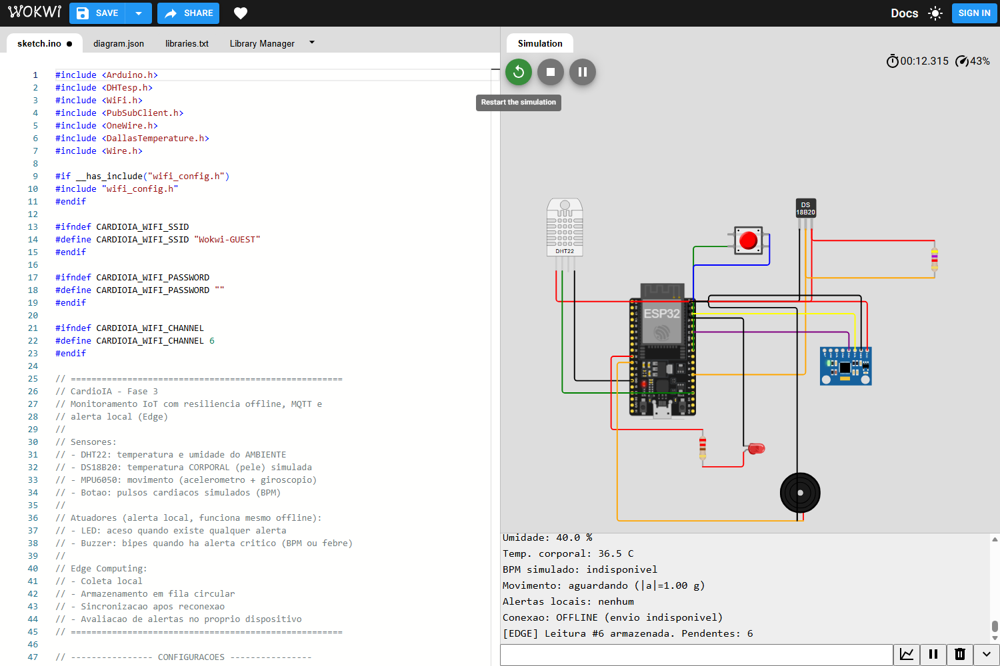
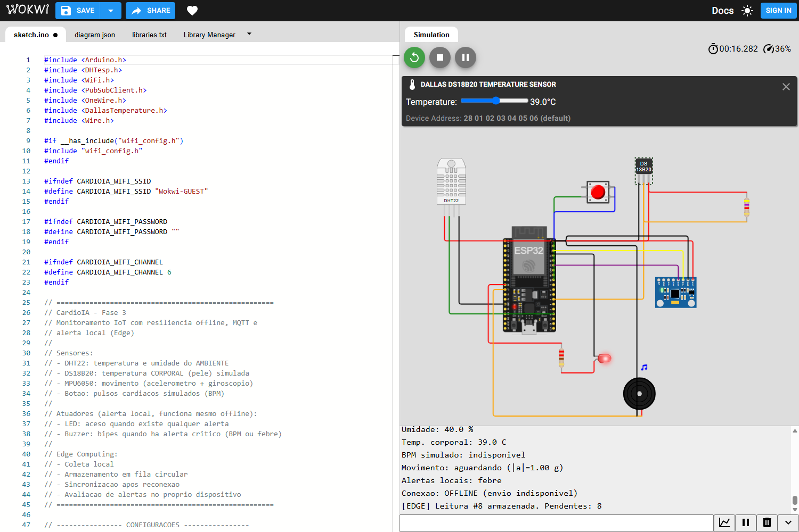
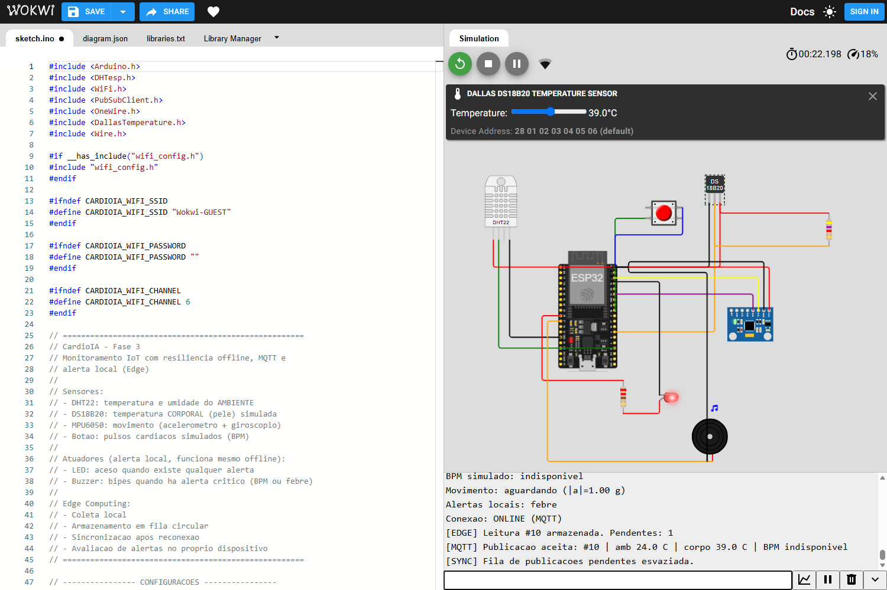

# CardioIA — Fase 3
## Relatório Técnico — Parte 1: Edge Computing e Resiliência Offline

> ⚠️ **AVISO CLÍNICO:** Este sistema é um protótipo acadêmico e **NÃO** substitui avaliação médica.
> Supervisionado por Dra. Fernanda Fassina (CRM-SP 169944).

**Equipe (Grupo S — FIAP):** Caroline de Castro Corrêa (RM567255), Enzo França Sader (RM566928), Lucas Hideki Oliveira Koyama (RM566925), Rodrigo Dias Figueiroa (RM567800) e Tiago Lindgren Curi (RM567016).

### 1. Introdução

O projeto CardioIA, desenvolvido no curso de Inteligência Artificial da FIAP, tem como objetivo explorar a aplicação de tecnologias inteligentes no contexto da saúde cardiovascular.

Na Fase 3, foi desenvolvido um protótipo de monitoramento contínuo utilizando um microcontrolador ESP32 simulado na plataforma Wokwi. A implementação demonstra a coleta periódica de sinais vitais, o processamento local de informações e a capacidade de continuar operando durante interrupções de conectividade.

O principal objetivo desta etapa é demonstrar o conceito de **Edge Computing**, no qual parte do processamento e do armazenamento ocorre próximo à origem dos dados, reduzindo a dependência de uma conexão permanente com serviços externos.

**Lugar da Fase 3 no projeto.** O CardioIA é um sistema acadêmico de apoio à decisão clínica para a triagem precoce da síndrome cardiorrenal-metabólica (CKM): a Fase 1 estruturou os dados e derivou o estágio CKM, e a Fase 2 aplicou NLP e um classificador de risco a relatos sintéticos de pacientes. A Fase 3 acrescenta o monitoramento contínuo, mas as frentes ainda não estão integradas: o protótipo não calcula nem consome o estágio CKM, e seus sinais e limiares são demonstrativos. Quais sinais contínuos interessam à triagem da CKM, e com quais limiares, é pendência de validação da Dra. Fernanda Fassina.

### 2. Componentes e tecnologias

O protótipo utiliza um ESP32 e quatro fontes de dados, além de dois atuadores de alerta:

- **DHT22:** leituras simuladas de temperatura e umidade relativa **do ambiente** (conta como um sensor, conforme o enunciado).
- **DS18B20:** temperatura **corporal** simulada, como se o sensor estivesse em contato com a pele. É ela que sustenta o alerta de febre, já que a temperatura ambiental não diz nada sobre febre.
- **MPU6050:** acelerômetro e giroscópio, usados para detectar movimento e a ausência dele.
- **Pushbutton:** simulador manual de pulsos cardíacos, que permite calcular uma estimativa de batimentos por minuto (BPM) a partir do intervalo entre acionamentos sucessivos.
- **LED e buzzer:** alerta local no próprio dispositivo.

O circuito foi desenvolvido na plataforma Wokwi e programado em C++, utilizando o ambiente Arduino e as bibliotecas DHTesp, OneWire e DallasTemperature. O mesmo firmware foi estendido na Parte 2 com Wi-Fi e MQTT (biblioteca PubSubClient); este relatório descreve a camada Edge, e a comunicação com a nuvem está em [`relatorio_mqtt.md`](relatorio_mqtt.md).

**Conexões utilizadas:**

- DHT22: alimentação de 3,3 V, sinal de dados conectado ao GPIO 15 e aterramento GND.
- DS18B20: alimentação de 3,3 V, dados (DQ) no GPIO 4 com resistor de pull-up de 4,7 kΩ até 3,3 V, e GND.
- MPU6050: barramento I2C (endereço 0x68) com SDA no GPIO 21 e SCL no GPIO 22, alimentação de 3,3 V e GND.
- Pushbutton: conectado ao GPIO 18 e ao GND, com configuração `INPUT_PULLUP`.
- LED vermelho: GPIO 26 por um resistor de 220 Ω, com o outro terminal em GND.
- Buzzer: GPIO 27 no terminal positivo e GND no negativo.

### 3. Funcionamento do monitoramento

O ESP32 executa continuamente a leitura dos componentes conectados.

A coleta de temperatura e umidade acontece em intervalos de aproximadamente dois segundos. Paralelamente, o sistema monitora o botão responsável pela simulação dos pulsos cardíacos.

O código utiliza a função `millis()` para controlar intervalos temporais sem interromper completamente o processamento, evitando os bloqueios causados pela utilização prolongada de `delay()`.

A estimativa de BPM utiliza a fórmula:

**BPM = 60.000 / intervalo entre pulsos, em milissegundos.**

A implementação também possui uma rotina de *debounce* para reduzir múltiplas detecções provocadas por oscilações do botão e um mecanismo de expiração da estimativa quando não há novos pulsos durante quatro segundos.

Quando não existe uma estimativa válida, o programa identifica o BPM como indisponível, evitando interpretá-lo como medição fisiológica real.

**Temperatura corporal.** A conversão do DS18B20 leva até 750 ms; esperar por ela travaria a leitura do botão e distorceria o cálculo do BPM. Por isso o firmware pede a conversão, segue o `loop()` e lê o resultado cerca de 0,8 s depois, repetindo o ciclo. Leituras fora da faixa do sensor (por exemplo, o valor -127 de sensor desconectado) são marcadas como inválidas.

**Movimento.** O MPU6050 é lido a cada 100 ms. Considera-se que há movimento quando a aceleração varia mais de 0,05 g entre duas amostras ou quando o giro passa de 10 °/s; um valor constante (parado, mesmo inclinado) não conta. O estado resultante é `aguardando` (ainda sem movimento desde a inicialização), `ativo`, `parado` (15 s sem movimento depois de já ter havido algum) ou `indisponivel` (o sensor não responde). O alerta de "sem movimento" só vale depois do primeiro movimento, para que um dispositivo ainda guardado, em repouso, não alerte; os 15 s são um valor de demonstração (em uso real seriam minutos).

### 3.1 Alertas locais (Edge)

O firmware avalia os limiares **no próprio ESP32**, a cada passagem do `loop()`, sem depender de Wi-Fi, do broker ou do dashboard:

| Condição | Resposta local |
|---|---|
| BPM válido acima de 120 | LED aceso e buzzer (bipe de 150 ms por segundo) |
| Temperatura corporal acima de 38 °C | LED aceso e buzzer |
| Parado por 15 s depois de já ter havido movimento | LED aceso, sem buzzer |

Esse é o ponto central do conceito de Edge Computing neste projeto: em um monitor cardíaco, o aviso mais importante precisa funcionar justamente quando a rede cai. O alerta também é registrado em cada leitura (campo `alertas_locais`, uma máscara de bits), de modo que o dashboard exibe o que o dispositivo decidiu. Os limiares são regras demonstrativas, não critérios de diagnóstico. No boot há um autoteste de 200 ms do LED e do buzzer.

### 4. Estratégia de resiliência offline

Para simular interrupções de conectividade, o programa utiliza uma variável booleana. Na versão inicial (somente Serial) ela se chamava `wifiConectado`; no firmware atual, que também faz a conexão real ao Wi-Fi do Wokwi e ao broker, o mesmo papel é exercido por `envioHabilitado`, alternada pelos comandos `f` e `o` do Monitor Serial. O dispositivo **inicia offline** para evidenciar a resiliência.

Quando seu valor é `false`, o sistema entra em modo offline. Nesse estado, a coleta dos sensores e os alertas locais continuam normalmente, mas as leituras não são transmitidas.

Os registros são armazenados temporariamente em uma **fila circular em memória RAM**, com capacidade fixa de 1.800 leituras.

Considerando um intervalo aproximado de dois segundos por coleta, essa capacidade corresponde a cerca de uma hora de dados acumulados.

Cada registro contém um identificador sequencial, o tempo decorrido desde o início da execução, temperatura e umidade ambientais, temperatura corporal, BPM estimado, o módulo da aceleração, o estado de movimento, a máscara de alertas locais e indicadores de validade do BPM e da temperatura corporal.

Quando a fila atinge sua capacidade máxima, a leitura mais antiga é descartada para permitir a entrada de uma nova leitura. O sistema também contabiliza o número de descartes, possibilitando identificar perdas durante períodos prolongados sem conexão.

Essa política de armazenamento limitado foi escolhida para demonstrar uma estratégia de gestão de memória em dispositivos embarcados.

### 5. Reconexão e sincronização

Quando a conexão simulada é restaurada (comando `o`), a variável de conectividade passa para `true`.

Nesse momento, o ESP32 inicia a sincronização dos registros pendentes, processando as leituras na ordem em que foram coletadas.

A implementação limita o processamento a dez registros por passagem do loop principal, evitando concentrar toda a execução na rotina de sincronização.

Na versão inicial (Parte 1), a transmissão era representada por mensagens JSON exibidas no Monitor Serial, conforme o enunciado. No firmware atual, a mesma rotina publica cada leitura em JSON no tópico MQTT (Parte 2) e imprime no Monitor Serial um resumo do dado enviado (por exemplo, `[MQTT] Publicacao aceita: #12 | amb 24.0 C | corpo 36.5 C | BPM indisponivel`), de modo que o "envio via `Serial.println`" descrito no enunciado continua visível.

A remoção de um registro da fila ocorre somente após a função de transmissão retornar sucesso, isto é, após `mqtt.publish()` aceitar a mensagem. Como a publicação usa QoS 0, esse sucesso indica apenas que a biblioteca enviou a mensagem, e não que o broker a recebeu; esse limite é discutido em [`relatorio_mqtt.md`](relatorio_mqtt.md).

**Dimensionamento da fila.** Cada registro ocupa 32 bytes (dois `unsigned long`, cinco `float` e quatro campos de 1 byte), então 1.800 registros usam 57.600 bytes (cerca de 57,6 KB) de RAM. Na compilação do firmware completo para ESP32 (PlatformIO, placa `esp32dev`, plataforma espressif32 8.0.0 com Arduino-ESP32 3.3.12, o mesmo core do Wokwi; configuração no README da Fase 3), o uso total de RAM estática foi de cerca de 106 KB dos 320 KB disponíveis (32,5%), já incluindo a pilha Wi-Fi/MQTT e a fila, e o uso de memória flash foi de 77,9%. A capacidade de uma hora de coleta foi escolhida como compromisso entre autonomia offline e memória: para um monitor vestível, uma hora cobre quedas curtas de conectividade (deslocamentos, elevadores, instabilidade de rede) sem consumir parte relevante dos recursos do ESP32. Acima disso, a política é descartar a leitura mais antiga e manter as mais recentes, que são as mais relevantes para o monitoramento.

### 6. Testes realizados e resultados

O funcionamento do protótipo foi verificado no ambiente Wokwi. Os testes de coleta e de resiliência abaixo foram feitos na versão inicial do firmware (transmissão simulada pelo Serial); a verificação com publicação MQTT e dashboard está em [`relatorio_mqtt.md`](relatorio_mqtt.md) e nas capturas de [`evidencias/`](evidencias/).

Inicialmente, foi confirmada a leitura periódica do DHT22, com valores simulados de temperatura e umidade apresentados no Monitor Serial.

Em seguida, foram realizados acionamentos do pushbutton, confirmando a detecção dos pulsos e o cálculo da estimativa de BPM.

Para validar a resiliência, o dispositivo foi mantido em estado offline durante múltiplos ciclos de coleta.

O Monitor Serial demonstrou o armazenamento de três leituras pendentes:

- Leitura 1: aproximadamente 2.000 ms.
- Leitura 2: aproximadamente 4.000 ms.
- Leitura 3: aproximadamente 6.000 ms.

Após a restauração da conexão, o sistema exibiu a sincronização das três leituras, mantendo seus identificadores e a ordem original.

Em seguida, uma nova leitura foi coletada no estado online e transmitida normalmente.

Esses resultados demonstram, no ambiente simulado, a continuidade da coleta durante períodos offline e o esvaziamento da fila após o restabelecimento da conectividade.

**Extensões posteriores (DS18B20, MPU6050, LED e buzzer).** A suíte automatizada cobre as regras de alerta e o contrato firmware × fluxo × documentação (95 testes aprovados nesta revisão). No Wokwi, a execução final de 2026-11-04 (o `sketch.ino` do repositório colado no editor do projeto indicado no README, em sessão anônima, a 18 % a 43 % da velocidade real) confirmou, em 38 verificações aprovadas (Serial lido pelo console da página): o boot com DS18B20 e MPU6050 encontrados e modo inicial offline, a coleta offline com a fila crescendo (ids sequenciais), o alerta local de febre (LED aceso e indicador de som no buzzer) com o DS18B20 em 39 °C, a publicação das leituras pendentes em ordem após habilitar o envio, cada uma com o resumo do dado no Serial, o BPM pelo botão (14 cliques a cerca de 150 BPM, com alerta local), o alerta de sem movimento do MPU6050 após 15,0 s simulados parado e a queda simulada (`f`), com a coleta e os alertas locais continuando (capturas 12 a 16 e 22 em [`evidencias/validacao-2026-11-04/`](evidencias/validacao-2026-11-04/)). O som do buzzer foi verificado apenas pelo indicador visual do simulador. O roteiro e o histórico, incluindo a falha de build anterior por falta do `sketch.ino` no projeto, estão em [`roteiro_teste_wokwi.md`](roteiro_teste_wokwi.md). Como a sessão era anônima, as capturas mostram a aba `sketch.ino ●` (não salvo); o dono da conta salvou depois o mesmo arquivo no projeto do link, e `sketch.ino` e `diagram.json` do projeto foram conferidos por diff como idênticos aos do repositório. As figuras a seguir são dessa execução.

*Figura 1 — Circuito no Wokwi e coleta offline: `Conexao: OFFLINE`, `Alertas locais: nenhum` e a fila crescendo (`Pendentes: 6` na leitura #6). O print mostra só as últimas linhas do Serial.*

*Figura 2 — Alerta local sem rede: com o DS18B20 em 39 °C, o ESP32 acende o LED e registra `Alertas locais: febre` mesmo com `Conexao: OFFLINE` (a fila já tem 8 leituras pendentes).*

*Figura 3 — Sincronização: depois do comando `o`, as 9 leituras pendentes (#1 a #9) são publicadas em ordem e a fila é esvaziada (`[SYNC] Fila de publicacoes pendentes esvaziada.`). Cada publicação traz o resumo do dado no Serial, como na linha `[MQTT] Publicacao aceita: #10 | amb 24.0 C | corpo 39.0 C | BPM indisponivel` que aparece no print.*

### 7. Limitações e considerações de segurança

O protótipo apresenta limitações decorrentes de seu caráter acadêmico.

O armazenamento em memória RAM é volátil. Portanto, as leituras são perdidas quando a simulação é encerrada ou o dispositivo é reiniciado.

Não foi implementado armazenamento persistente em SPIFFS, considerando as limitações do ambiente de simulação e o caráter opcional desse requisito.

Além disso, o DHT22 mede temperatura e umidade ambientais, não temperatura corporal; a febre é avaliada no DS18B20, cujo valor é ajustado manualmente no simulador. Os pulsos cardíacos são simulados por acionamentos manuais, e o movimento vem de controles do simulador: nada disso representa medições obtidas de pacientes. O Wokwi não possui sensor de batimento cardíaco; em um dispositivo real o botão seria substituído por um sensor óptico de pulso (como o MAX30102 ou o PulseSensor), com detecção de picos no próprio ESP32.

A variável de conectividade é um interruptor de teste (`f`/`o`): ela simula a queda e a volta da rede, mas não detecta falhas reais de Wi-Fi. A confiabilidade da entrega ao broker também é limitada pelo QoS 0 (ver `relatorio_mqtt.md`). Com o envio habilitado, cada tentativa de conexão ao broker bloqueia o `loop()` enquanto tenta: a espera pelo broker é limitada a 3 s, mas com o broker ou o DNS fora do ar a coleta ainda pode atrasar e cliques podem se perder por alguns segundos; com o envio desabilitado (`f`) a coleta não é afetada.

Os limiares de alerta existem em dois lugares, o firmware (alerta local) e o dashboard (camada Fog); mudar um exige mudar o outro. O alerta de "sem movimento" depende do primeiro movimento detectado e usa 15 s para demonstração, e a temperatura corporal vem de um único sensor, sem calibração, filtro de ruído ou verificação de contato com a pele.

Para uma aplicação médica real, seriam necessários sensores adequados e validados, armazenamento persistente, proteção de dados, comunicação criptografada, autenticação, mecanismos confiáveis de confirmação de entrega e avaliação de segurança clínica.

### 8. Conclusão

A implementação da Parte 1 da Fase 3 demonstrou os principais conceitos de Edge Computing aplicados a um protótipo de monitoramento cardiovascular simulado.

O sistema conseguiu realizar leituras periódicas de quatro fontes de dados, calcular uma estimativa de BPM, avaliar alertas no próprio dispositivo com resposta imediata em LED e buzzer, armazenar informações temporariamente durante uma desconexão e sincronizar os registros após a recuperação da conectividade.

Essa base foi então integrada a um broker MQTT e a um dashboard Node-RED com alertas automáticos, descritos no relatório da Parte 2.

### Referência do protótipo

**Projeto no Wokwi:** https://wokwi.com/projects/479773169716093953

**Repositório:** https://github.com/Grupo-S-faculdade-FIAP/cardioIA

**Código:** [`fase3/esp32/sketch.ino`](../esp32/sketch.ino) · **Evidências:** [`fase3/docs/evidencias/`](evidencias/) · **Relatório da Parte 2:** [`relatorio_mqtt.md`](relatorio_mqtt.md)
