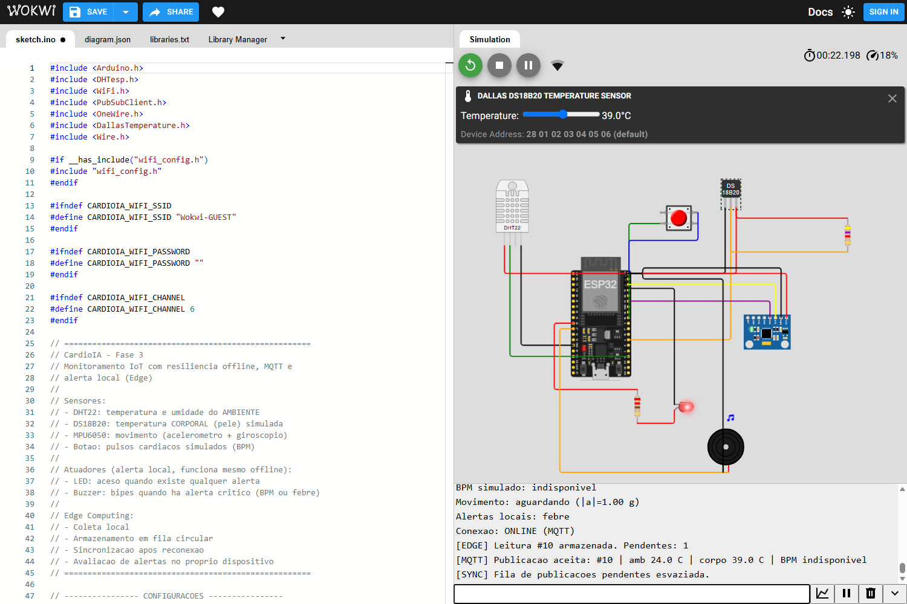
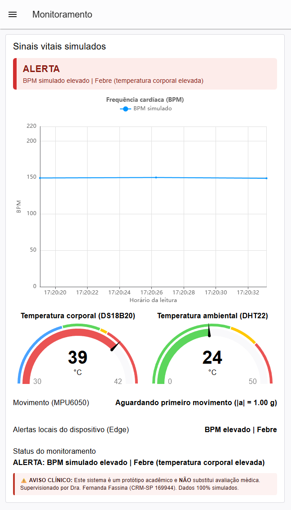
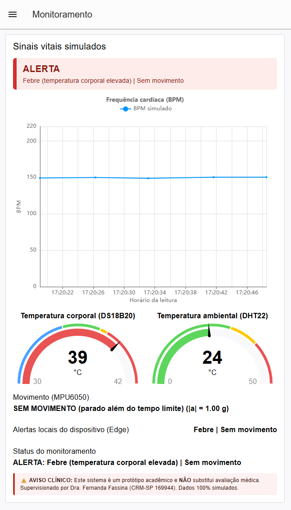
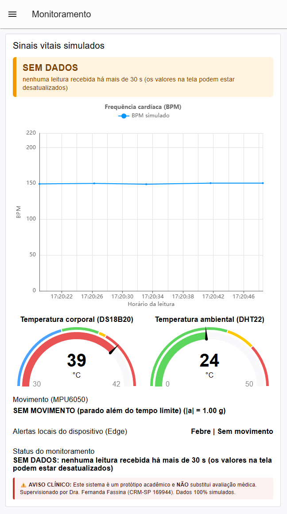
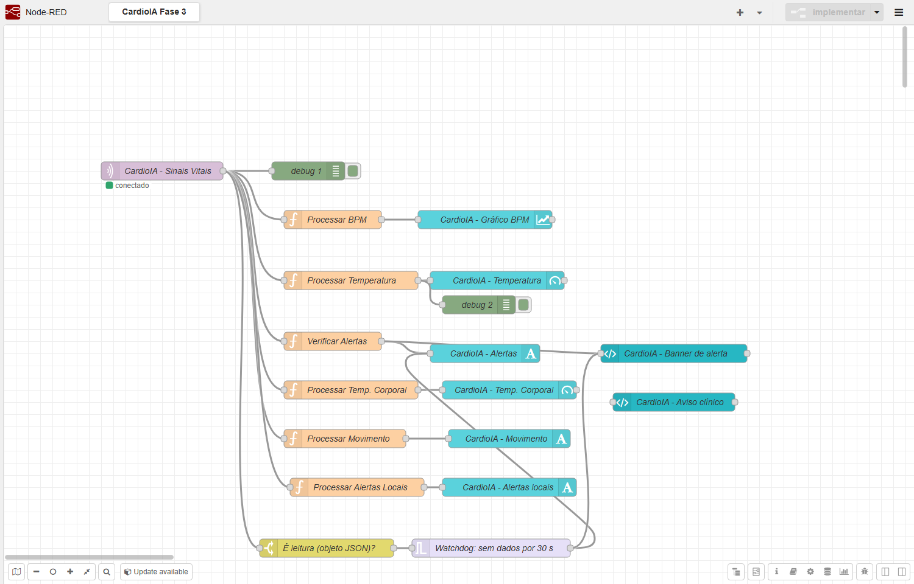

# CardioIA — Fase 3

## Relatório técnico — Parte 2: Comunicação MQTT, Fog/Cloud e dashboard de monitoramento

> ⚠️ **AVISO CLÍNICO:** Este sistema é um protótipo acadêmico e **NÃO** substitui avaliação médica.
> Supervisionado por Dra. Fernanda Fassina (CRM-SP 169944).

**Equipe (Grupo S — FIAP):** Caroline de Castro Corrêa (RM567255), Enzo França Sader (RM566928), Lucas Hideki Oliveira Koyama (RM566925), Rodrigo Dias Figueiroa (RM567800) e Tiago Lindgren Curi (RM567016).

### 1. Objetivo e escopo

A segunda parte da Fase 3 do CardioIA demonstra a transmissão de dados de um protótipo de monitoramento baseado em IoT para uma camada de processamento e visualização. O dispositivo é um ESP32 **simulado no Wokwi**, conectado a um sensor DHT22 (temperatura e umidade do ambiente), a um DS18B20 (temperatura corporal simulada), a um MPU6050 (movimento) e a um botão de pressão que representa pulsos cardíacos manuais, com LED e buzzer para alerta local. O objetivo não é realizar diagnóstico médico, mas implementar e demonstrar coleta periódica, comunicação por MQTT, recepção de eventos e alertas em um dashboard.

A solução aproveita a etapa anterior de Edge Computing: as amostras são produzidas e armazenadas localmente em uma fila circular com capacidade máxima de 1.800 registros. Quando a publicação está indisponível, novas leituras continuam sendo coletadas; ao restabelecer a transmissão, o ESP32 tenta enviar os registros pendentes na ordem de chegada.

**Lugar da Fase 3 no projeto.** O CardioIA é um sistema acadêmico de apoio à decisão clínica para a triagem precoce da síndrome cardiorrenal-metabólica (CKM): a Fase 1 estruturou os dados e derivou o estágio CKM, e a Fase 2 aplicou NLP e um classificador de risco a relatos sintéticos de pacientes. A Fase 3 acrescenta o monitoramento contínuo, mas as frentes ainda não estão integradas: o protótipo não calcula nem consome o estágio CKM, e seus sinais e limiares são demonstrativos. Quais sinais contínuos interessam à triagem da CKM, e com quais limiares, é pendência de validação da Dra. Fernanda Fassina.

### 2. Arquitetura e componentes

O fluxo de informações segue esta arquitetura:

```text
[DHT22 + DS18B20 + MPU6050 + botão] → [ESP32 / Wokwi: coleta, BPM, fila Edge, alerta local]
                                              │                    └──► LED + buzzer
                                              │ Wi-Fi simulado / MQTT (TCP 1883)
                                              ▼
                                     [broker.hivemq.com]
                                              │
                                              │ tópico MQTT
                                              ▼
                                       [Node-RED local]
                                         ├── Processar BPM → gráfico temporal
                                         ├── Processar Temperatura → gauge ambiental
                                         ├── Processar Temp. Corporal → gauge corporal
                                         ├── Processar Movimento → texto
                                         ├── Processar Alertas Locais → texto
                                         ├── Verificar Alertas → texto de status + banner de alerta
                                         └── Watchdog "sem dados" → texto de status + banner de alerta
```

**Camada Edge:** o ESP32 lê temperatura e umidade do DHT22 e a temperatura corporal do DS18B20 a cada dois segundos, lê o MPU6050 a cada 100 ms, interpreta os acionamentos do botão como pulsos simulados e guarda os dados localmente. O BPM é estimado pelo intervalo entre pulsos; sem intervalo recente válido, a leitura é marcada como inválida. O uso de `bpm_valido` (e de `temp_corporal_valida`) impede que o valor zero seja confundido com uma medição clínica. O firmware também avalia os limiares de alerta localmente e aciona LED e buzzer sem depender da rede; o resultado viaja na mensagem como `alertas_locais`.

**Mensageria:** a biblioteca `PubSubClient` publica mensagens JSON em um broker MQTT de testes. O broker usado é `broker.hivemq.com`, porta `1883`, sem TLS e sem autenticação. O tópico configurado é `cardioia/fiap/fase3/enzf-477362937220720641/sinais`.

**Camada de visualização (Fog/aplicação):** o Node-RED é executado localmente (nos testes do grupo, em Windows) e atua como cliente MQTT inscrito no mesmo tópico. As mensagens alimentam um gráfico de BPM, medidores de temperatura corporal e ambiental, indicadores textuais de movimento e de alertas locais do dispositivo, um indicador textual de alertas avaliados no próprio dashboard, um banner colorido com o estado geral, o aviso clínico e um aviso de "sem dados" quando o dispositivo para de enviar. A arquitetura demonstra integração com um broker remoto, mas **não equivale à implantação de uma infraestrutura própria de nuvem ou a um serviço clínico de produção**.

### 3. Estrutura das mensagens

Cada amostra publicada possui um identificador sequencial, um instante relativo à inicialização do ESP32 (`millis()`), os dados dos sensores, as indicações de validade e a máscara de alertas locais. Exemplo representativo:

```json
{
  "dispositivo": "cardioia-esp32-01",
  "id": 9,
  "timestamp_ms": 18000,
  "temperatura": 24.0,
  "umidade": 40.0,
  "temp_corporal": 36.5,
  "temp_corporal_valida": true,
  "bpm": 0.0,
  "bpm_valido": false,
  "movimento": "aguardando",
  "aceleracao_g": 1.00,
  "alertas_locais": 0
}
```

| Campo | Significado |
|---|---|
| `temperatura`, `umidade` | DHT22: leituras do **ambiente** |
| `temp_corporal`, `temp_corporal_valida` | DS18B20: temperatura corporal simulada; com `false`, o valor é ignorado |
| `bpm`, `bpm_valido` | Estimativa a partir dos cliques do botão; com `false`, o valor é ignorado |
| `movimento` | `aguardando` (sem movimento desde o boot), `ativo`, `parado` (15 s sem movimento após já ter havido) ou `indisponivel` |
| `aceleracao_g` | Módulo da aceleração do MPU6050 (cerca de 1,00 g em repouso) |
| `alertas_locais` | Máscara de bits decidida pelo ESP32: 1 = BPM elevado, 2 = febre, 4 = sem movimento |

`timestamp_ms` **não é um horário civil absoluto**: representa o tempo decorrido desde o início da simulação. Os campos `temperatura` e `umidade` são leituras ambientais do DHT22; um limiar neles **não identifica febre**, que é avaliada em `temp_corporal`. O BPM é produzido por acionamentos manuais do botão, e a temperatura corporal e o movimento por controles do simulador, e não por sensores fisiológicos reais.

### 4. Resiliência e reenvio de dados

O firmware possui uma fila circular de 1.800 leituras. Com coletas a cada dois segundos, essa capacidade corresponde, em condições nominais, a aproximadamente uma hora de registros. Quando a fila fica cheia, o item mais antigo é substituído e o sistema registra a quantidade de descartes. Esse armazenamento é **volátil, em memória RAM**: reiniciar ou desligar o ESP32 elimina as amostras ainda não enviadas.

No Monitor Serial, o comando `f` desabilita a publicação e permite demonstrar a retenção de leituras; `o` habilita novamente a transmissão; e `s` apresenta o status. Após a reconexão ao Wi-Fi e ao broker, o firmware tenta publicar os dados acumulados em lotes limitados por passagem do loop, evitando concentrar todo o processamento em uma única operação.

A confirmação de `mqtt.publish(...)` indica que a biblioteca aceitou a publicação naquela conexão. **Não demonstra, isoladamente, entrega persistente no broker ou consumo pelo Node-RED**. A implementação utiliza publicação MQTT com QoS 0; portanto, não oferece confirmação fim a fim nem garantia de entrega. Para uma aplicação real, seriam necessários níveis apropriados de QoS, persistência, tratamento de duplicações e uma estratégia explícita de confirmação dos dados recebidos.

### 5. Implementação do dashboard no Node-RED

O fluxo foi construído usando o Node-RED e os widgets da biblioteca `@flowfuse/node-red-dashboard` (Dashboard 2.0). Um nó `mqtt in` recebe os eventos do tópico do CardioIA e os encaminha a seis funções independentes:

1. **Processar BPM:** verifica se `bpm_valido` é verdadeiro e se `bpm` é numérico. Somente as leituras válidas seguem ao gráfico de linhas, cuja escala representa BPM.
2. **Processar Temperatura:** verifica a presença de valor numérico em `temperatura` e o envia ao *gauge* da temperatura **ambiental**, em graus Celsius, com escala de 0 a 50 °C e faixas de cor alinhadas ao limiar de alerta: verde até 30 °C, amarelo de 30 a 38 °C e vermelho a partir de 38 °C.
3. **Processar Temp. Corporal:** só encaminha `temp_corporal` quando `temp_corporal_valida` é verdadeiro. O *gauge* da temperatura **corporal** tem escala de 30 a 42 °C: azul até 35 °C, verde de 35 a 37,5 °C, amarelo de 37,5 a 38 °C e vermelho a partir de 38 °C.
4. **Processar Movimento:** converte o campo `movimento` em texto (`Em movimento`, `Aguardando primeiro movimento`, `SEM MOVIMENTO…` ou `Sensor de movimento indisponível`) acompanhado do módulo da aceleração.
5. **Processar Alertas Locais:** decodifica a máscara `alertas_locais` e mostra o que o **dispositivo** decidiu (`BPM elevado`, `Febre`, `Sem movimento` ou `Nenhum`), tornando visível no dashboard o alerta do Edge.
6. **Verificar Alertas:** avalia as regras do dashboard (Fog) e gera `ALERTA: ` seguido da lista de condições separadas por ` | `: `BPM simulado elevado` (BPM válido acima de 120), `Febre (temperatura corporal elevada)` (temperatura corporal válida acima de 38 °C), `Sem movimento` (estado `parado`) e `Temperatura ambiental elevada` (DHT22 acima de 38 °C). Caso nenhuma condição seja atendida, o texto indica `Monitoramento sem alertas ativos`.

Além das seis funções, o fluxo tem três recursos de segurança e de legibilidade:

- **Watchdog de "sem dados":** um nó `switch` deixa passar só mensagens cujo conteúdo é um objeto JSON e um nó `trigger` de 30 s reinicia o prazo a cada leitura. Se o prazo vence, o texto de status e o banner passam a `SEM DADOS: nenhuma leitura recebida há mais de 30 s (os valores na tela podem estar desatualizados)`; na leitura seguinte, voltam ao normal. Sem ele, um ESP32 parado deixaria o painel mostrando o último estado, inclusive `Monitoramento sem alertas ativos`, como se fosse atual. O prazo e o texto estão no [contrato MQTT](contrato_mqtt.md), e os testes exigem que o prazo seja pelo menos cinco vezes o intervalo de coleta do firmware.
- **Banner de alerta:** um `ui-template` no topo do painel resume o estado em uma palavra e uma cor: vermelho (`ALERTA`), laranja (`SEM DADOS`), verde (`SEM ALERTAS`) ou cinza (`AGUARDANDO DADOS`, antes da primeira leitura). Ele lê o mesmo texto de status do nó "Verificar Alertas" e do watchdog.
- **Aviso clínico:** o aviso obrigatório do projeto aparece no rodapé do painel (outro `ui-template`, com texto fixo).

Esses valores de corte são **regras demonstrativas**, escolhidas para o exercício acadêmico, e não critérios de diagnóstico. O mesmo conjunto de limiares existe no firmware (alerta local) e no dashboard; mudar um exige mudar o outro. O [contrato MQTT](contrato_mqtt.md) registra onde cada regra mora, e testes automatizados conferem a consistência entre firmware, fluxo e documentos. O status textual descreve a avaliação da última mensagem recebida; se as mensagens param, o watchdog avisa "sem dados". Na implementação atual, a ausência de BPM válido ainda não é diferenciada visualmente de uma medição válida sem alerta; essa limitação deve ser corrigida antes de qualquer uso mais crítico.

O gráfico exibe a evolução dos valores válidos recebidos, enquanto os gauges mostram as temperaturas da última amostra processada. O fluxo exportado em JSON permite importar a configuração em outra instância compatível de Node-RED, desde que os pacotes necessários estejam instalados.

### 6. Testes e resultados

As capturas antigas foram removidas porque mostravam uma versão anterior do sistema. Os resultados históricos de testes feitos nessa versão não são usados como evidência da implementação atual.

**Verificações automatizadas da versão atual.**

| Verificação | Método | Resultado |
|---|---|---|
| Compilação do firmware | PlatformIO, placa `esp32dev`, plataforma espressif32 8.0.0 com Arduino-ESP32 3.3.12 (o mesmo core do Wokwi); bibliotecas DHT sensor library for ESPx 1.19.0, PubSubClient 2.8.0, OneWire 2.3.8 e DallasTemperature 4.0.6 (configuração no README da Fase 3) | Sem erros nem avisos no sketch; RAM 32,5% (106.492 bytes), flash 77,9% (1.021.687 bytes). Conferido de novo em 2026-11-04, depois das últimas mudanças do firmware |
| Regras e contrato do Node-RED | 95 testes sobre as funções do fluxo, o contrato firmware × fluxo × documentação (incluindo limites, leituras inválidas, formato antigo e máscara `alertas_locais`), o watchdog de "sem dados", o aviso clínico e a robustez da conexão do firmware | 95 passaram; 0 falharam (`node --test tests/funcoes.test.mjs tests/contrato.test.mjs`) |
| Integridade do fluxo exportado | Verificação de ids duplicados e fios quebrados no JSON | Sem problemas |
| Build do projeto público Wokwi | Início da simulação em navegador automatizado no projeto [`cardioIAiot`](https://wokwi.com/projects/479773169716093953) | Passou depois de o `sketch.ino` ser adicionado ao projeto, em 2026-11-04. Antes disso o build falhava com `setup()` e `loop()` indefinidos (captura 06 em `evidencias/validacao-2026-11-04/`) |
| Recepção MQTT e dashboard Node-RED | Node-RED 5.0.9 isolado, Dashboard 2.0 1.33.0, mensagem sintética publicada no tópico do contrato | Passou: os dois gauges mostraram 39 °C, movimento `parado`, máscara local 7 e status com os quatro alertas esperados. Capturas 07 e 08 em `evidencias/validacao-2026-11-04/` |
| Execução no Wokwi (ESP32 simulado) até o dashboard | `sketch.ino` do repositório colado no editor do projeto do link acima (sessão anônima, sem salvar), em navegador automatizado (Playwright com Edge) a 18 % a 43 % da velocidade real, com o dashboard do Node-RED local (fluxo do repositório); 38 verificações seguindo o [`roteiro_teste_wokwi.md`](roteiro_teste_wokwi.md) | Passou (38 de 38): boot e coleta offline com a fila crescendo; alerta local de febre com LED e indicador de som no buzzer; após `o`, Wi-Fi e broker conectados, 9 leituras publicadas em ordem, cada uma com o resumo do dado no Serial, e fila esvaziada; dashboard com banner e alertas de febre, de BPM (14 cliques a cerca de 150 BPM) e de sem movimento (15,0 s simulados); `f` com a coleta continuando e, 27 s depois, `SEM DADOS` no dashboard; `o` de novo com as leituras do período offline em ordem. Capturas 12 a 19, 21 e 22. Depois, o dono da conta salvou o mesmo arquivo no projeto do link (diff: `sketch.ino` e `diagram.json` idênticos aos do repositório). **Não verificado:** o som do buzzer (só o indicador visual) |
| Watchdog, banner e aviso clínico (broker local, casos que o Wokwi não cobre) | Node-RED 5.0.9 real, Dashboard 2.0 1.33.0 e um broker MQTT local, com 13 conferências sobre o DOM do dashboard (dado sintético gerado pelo teste, não do Wokwi; o script não está no repositório) | Passou (13 de 13): estado inicial `AGUARDANDO DADOS`; leitura normal `SEM ALERTAS`; alerta de BPM e febre `ALERTA`; 50 s com leituras a cada 10 s sem `SEM DADOS`; mais de 30 s só com mensagens que não são JSON resultam em `SEM DADOS`; a leitura seguinte restaura o estado; aviso clínico visível |
| Editor do Node-RED | Fluxo do repositório importado numa instância isolada do Node-RED 5.0.9, conectada ao broker público (só assina o tópico) | Nó `mqtt in` **conectado** (captura 20) |

No gráfico, várias leituras reprocessadas após a reconexão foram apresentadas com instantes de chegada próximos, em vez dos instantes originais de coleta. Uma evolução futura seria usar os identificadores e timestamps de origem para posicionar os registros no tempo e distinguir dados atrasados de dados recebidos em tempo real.

**Evidências e validação visual.** Todas as leituras vêm do ESP32 **simulado** no Wokwi; o projeto não usa hardware físico. As capturas 12 a 19, 21 e 22 (em [`evidencias/validacao-2026-11-04/`](evidencias/validacao-2026-11-04/)) documentam a execução final no projeto do link: coleta offline, alerta local de febre, sincronização da fila em ordem, BPM pelos cliques do botão, alerta de sem movimento e queda simulada com o aviso de "sem dados", com o dashboard do Node-RED recebendo cada alerta. As capturas 01 e 05 são de uma execução anterior no projeto `cardioiaiot` (ID 479766849694291969); a 06 registra a falha de build que o projeto do link tinha antes de receber o `sketch.ino`; a 07 e a 08 mostram o dashboard processando uma mensagem sintética no formato do firmware (dado gerado pelo teste, não pelo Wokwi); a 09 é a saída real do `npm test` (95 aprovados). As 38 verificações da execução final foram feitas por um script Playwright (fora do repositório), e o roteiro em [`roteiro_teste_wokwi.md`](roteiro_teste_wokwi.md) descreve os mesmos passos para execução manual. O som do buzzer não foi verificado (só o indicador visual). Como a sessão era anônima, as capturas mostram a aba `sketch.ino ●` (não salvo); o dono da conta salvou depois o mesmo arquivo no projeto do link, e `sketch.ino` e `diagram.json` do projeto foram conferidos por diff como idênticos aos do repositório. A captura 20 mostra o editor do Node-RED com o fluxo carregado e o nó MQTT conectado; foi feita sem o Wokwi em execução, então mostra como o dashboard foi montado e não mensagens recebidas.

As figuras a seguir reúnem as capturas principais, todas da execução final (firmware e dashboard atuais).



*Figura 1 — Serial do ESP32 simulado depois do comando `o`: as 9 leituras pendentes (#1 a #9) são publicadas em ordem, cada uma com o resumo do dado (`[MQTT] Publicacao aceita: #10 | amb 24.0 C | corpo 39.0 C | BPM indisponivel` no print), e a fila é esvaziada.*



*Figura 2 — Dashboard com dados recebidos do Wokwi: banner `ALERTA` com `BPM simulado elevado | Febre (temperatura corporal elevada)`, gráfico de BPM (cliques do botão a cerca de 150 BPM), medidores de temperatura corporal (39 °C) e ambiental (24 °C), alertas locais `BPM elevado | Febre`, status `ALERTA: BPM simulado elevado | Febre (temperatura corporal elevada)` e o aviso clínico no rodapé.*



*Figura 3 — Dashboard com o MPU6050 parado por 15 s: `SEM MOVIMENTO (parado além do tempo limite)`, banner `ALERTA` e status `ALERTA: Febre (temperatura corporal elevada) | Sem movimento`.*



*Figura 4 — Watchdog: depois do comando `f`, sem leituras por mais de 30 s, o status e o banner laranja passam a `SEM DADOS: nenhuma leitura recebida há mais de 30 s (os valores na tela podem estar desatualizados)`. Os medidores e os textos de movimento e de alertas locais seguem nos últimos valores, por isso o aviso.*



*Figura 5 — Editor do Node-RED (instância isolada, fluxo importado do repositório): o nó `mqtt in` conectado ao broker, as seis funções com seus widgets, o watchdog (`switch` e `trigger`), o banner de alerta e o aviso clínico.*

### 7. Limitações, segurança e possíveis melhorias

O broker empregado é **público e não criptografado**, adequado exclusivamente a testes com dados fictícios. Não se deve enviar nomes, informações identificáveis, dados reais de saúde, chaves de acesso ou segredos por esse canal. Em ambiente real seria necessário utilizar TLS, autenticação, controle de acesso por tópicos e políticas de privacidade e retenção.

O dispositivo é uma simulação: o Wokwi não possui sensor de batimento cardíaco (o botão faz esse papel), e a temperatura corporal e o movimento vêm de controles do simulador. Não existe avaliação clínica, calibração certificada ou validação de precisão. Além disso, o buffer em RAM não garante persistência após reinicialização, o MQTT em QoS 0 não garante entrega, e `millis()` não corresponde a um relógio sincronizado.

Os alertas são avaliados em dois lugares: no ESP32 (LED e buzzer, que funcionam mesmo offline) e no Node-RED (texto de status). Em contrapartida, os limiares ficam duplicados e precisam ser mantidos em sincronia. O alerta de "sem movimento" só vale depois do primeiro movimento detectado e usa 15 s para demonstração. O watchdog de "sem dados" usa 30 s reais: numa simulação muito lenta do Wokwi (poucos por cento da velocidade) ele pode avisar sem que nada tenha falhado. Do lado do ESP32, cada tentativa de conexão ao broker bloqueia o `loop()` enquanto tenta; a espera pelo broker é limitada a 3 s, mas com o broker ou o DNS fora do ar e o envio habilitado a coleta ainda pode atrasar por alguns segundos.

Em um dispositivo real, o botão seria substituído por um sensor óptico de pulso (como o MAX30102, por I2C, ou o PulseSensor, analógico), com detecção de picos no próprio ESP32, e o DS18B20 teria a sonda em contato com a pele.

Como próximos avanços são recomendados: armazenamento persistente quando aplicável, timestamps sincronizados (por exemplo, NTP), diferenciar visualmente a ausência de BPM válido de uma medição normal, detecção de queda com o MPU6050, tratamento de falhas com confirmações fim a fim, migração para um broker com TLS e autenticação (como o HiveMQ Cloud), controle de acesso e um teste automatizado ponta a ponta com o simulador (hoje os testes automatizados cobrem as regras de alerta e o contrato, e a execução no Wokwi é manual).

### 8. Conclusão

A Parte 2 integrou o protótipo Edge ao broker MQTT e ao Node-RED, permitindo observar leituras de temperatura e BPM simulado e disparar alertas automáticos por regras definidas. Os testes mostraram a continuidade da coleta durante a indisponibilidade da transmissão, a tentativa de sincronização após a reconexão e a atualização do dashboard com dados recebidos pelo consumidor MQTT.

O resultado atende ao propósito **didático** de demonstrar aquisição, transporte, processamento e visualização de telemetria IoT, deixando explícitas as limitações de segurança, durabilidade e confiabilidade que precisariam ser resolvidas para um sistema de monitoramento de saúde real.

### 9. Materiais de reprodução

- Simulação Wokwi: https://wokwi.com/projects/479773169716093953
- Firmware: `fase3/esp32/sketch.ino`
- Bibliotecas: `fase3/esp32/libraries.txt`
- Fluxo Node-RED: `fase3/node_red/cardioia-fase3-flow.json`
- Contrato MQTT: `fase3/docs/contrato_mqtt.md`
- Testes do Node-RED: `fase3/node_red/tests/` (`npm test` dentro de `fase3/node_red`)
- Dashboard local (com Node-RED em execução): `http://localhost:1880/dashboard`
- Relatório da Parte 1: `fase3/docs/relatorio_edge.md`
- Evidências (capturas de tela): `fase3/docs/evidencias/`
- Roteiro de teste no Wokwi: `fase3/docs/roteiro_teste_wokwi.md`
- Gerador dos PDFs dos relatórios: `fase3/docs/gerar_pdfs.py`
- Compilação de conferência no PlatformIO: `fase3/README.md` (seção "Compilar fora do Wokwi")
- Repositório: https://github.com/Grupo-S-faculdade-FIAP/cardioIA
